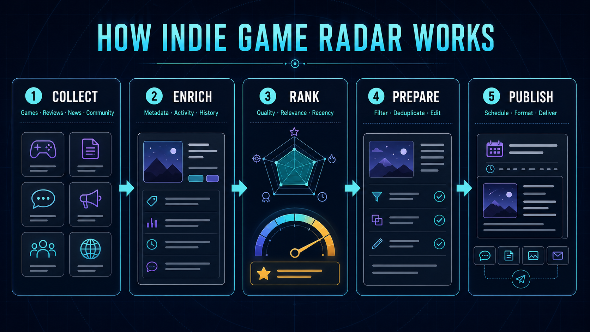
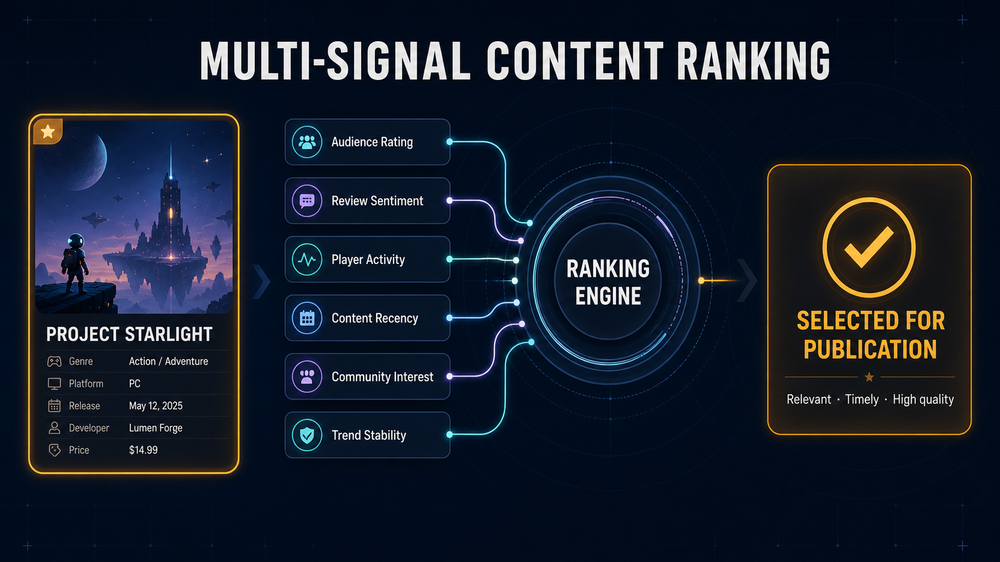

<div align="center">

# Indie Game Radar


**Automated indie game discovery & content pipeline.**<br/>
Monitors Steam, Reddit, IGDB and Speedrun.com for promising indie titles and community content,
scores it with a multi-signal ranking engine (plus LLM-assisted editorial filtering),
and publishes a curated daily schedule to Telegram.


[Features](#-features) •
[How it works](#-how-it-works) •
[Architecture](#-architecture) •
[Getting started](#-getting-started) •
[Configuration](#-configuration--tuning) •
[Deployment](#-deployment)

</div>

---

## 📖 About

Indie Game Radar is a long-running async worker that powers a Telegram channel with curated indie-game
content. It continuously harvests raw data from public APIs, enriches and ranks it, and converts the best
candidates into polished posts — game spotlights, news digests, discount alerts, review roundups,
speedrun leaderboards, community discussions and memes.

It is designed to run unattended 24/7: a harvester loop keeps the database fresh, a ranking loop
re-scores candidates every few minutes, and the orchestrator allocates the daily content mix across
morning/day/evening time windows.

## ✨ Features

- **Multi-source harvesting**
  - **Steam** — store details, prices, reviews, news, achievements, current players, full app list
  - **IGDB** — metadata enrichment via Twitch OAuth (ratings, popularity, recency)
  - **Reddit** — gamedev stories and memes via a resilient direct client (UA rotation, rate limiting, retries)
  - **Speedrun.com** — world-record leaderboards for freshly released games
- **Multi-signal ranking engine** — weighted scoring across user sentiment, popularity, recency,
  player activity, news velocity, price attractiveness and discounts, with trend-stability penalties
- **LLM-assisted curation** — OpenAI (`gpt-4o-mini`) filters low-value posts and rewrites drafts into
  polished Telegram posts; `text-embedding-3-small` powers semantic deduplication and game↔post matching
- **Content mix scheduling** — a daily quota (default 10 posts) is distributed across morning / day /
  evening windows by category priorities; if a category runs dry, the slot is redistributed
- **Publishing** — renders posts from templates into Telegram-safe HTML, supports text and photo posts,
  schedules messages, and forwards channel posts via a Telethon user client; optional Tumblr publishing
- **Production plumbing** — MongoDB (Motor) with a repository layer and soft deletes,
  rate-limited HTTP clients with retry/backoff, structured JSON logging (structlog), Docker + CI/CD

## 🔄 How it works



| Stage | What happens |
|---|---|
| **1. Collect** | `APIHarvesterService` pulls games, reviews, news, Reddit posts, memes and speedrun leaderboards on a rolling cycle aligned to **12:00 UTC** |
| **2. Enrich** | Steam data is merged with IGDB metadata and time-series snapshots (players, price, review ratio) stored in MongoDB |
| **3. Rank** | `RankEngineService` re-scores everything every **10 min**; dedicated rankers exist for games, news, gamedev stories and memes |
| **4. Prepare** | Category filters drop stale/weak/duplicate items; OpenAI validates candidates and `EditorialRefiner` rewrites the copy; embeddings deduplicate near-identical posts |
| **5. Publish** | `ContentAllocationStrategy` picks the daily mix and schedules it across **08:00–22:00 UTC**; `PublisherService` renders and delivers each post at its slot |

## 🧠 Ranking engine



Each candidate gets a `0.0–1.0` score from weighted signals (all weights and thresholds live in
[`src/config/constants.py`](src/config/constants.py)):

- **Audience rating & sentiment** — Steam review ratio weighted by review volume + recommendation counts
- **Player activity** — concurrent players and snapshot trends (log-smoothed)
- **Content recency** — release-date boost decaying over ~6 months; separate freshness decay per content type
- **Community interest** — Reddit engagement (upvotes, comments, awards, crossposts), subreddit quality
- **Price & discounts** — price-bucket attractiveness plus dynamic discount thresholds by price tier
- **Info value** — keyword-based content richness (releases/trailers > patch notes/hotfixes), media bonuses
- **Trend stability** — volatility penalties for erratic snapshots

Content that passes per-category filters becomes a `Publication` record with a `pending` status and enters
the daily allocation pool.

## 🏗 Architecture

```text
                          ┌─────────────────────────────────────────────┐
                          │                Orchestrator                 │
                          │  harvest loop · rank loop · publish cycle   │
                          └───────┬─────────────────┬───────────────────┘
                                  │                 │
            ┌─────────────────────▼───┐   ┌─────────▼──────────────────┐
            │   APIHarvesterService   │   │     RankEngineService      │
            │  steam · igdb · reddit  │   │ rankers · filters · dedup  │
            │  speedrun · snapshots   │   │ OpenAI checks · embeddings │
            └───────────┬─────────────┘   └────────────┬───────────────┘
                        │                              │
            ┌───────────▼──────────────────────────────▼───────────────┐
            │      MongoDB (Motor repos, soft deletes, snapshots)      │
            └───────────────────────────┬──────────────────────────────┘
                                        │
                          ┌─────────────▼──────────────┐
                          │      PublisherService      │
                          │ templates · HTML sanitizer │
                          │ TG Bot API · Telethon · T. │
                          └────────────────────────────┘
```

- **Entry point** — [`main.py`](main.py) → composition root [`src/container.py`](src/container.py) wires clients, repositories and services
- **`APIHarvesterService`** — collects games, news, reviews, Reddit posts and leaderboards into Mongo
- **`RankEngineService`** — scores + filters games, discounts, news, Reddit posts, reviews, leaderboards
- **`PublisherService`** — renders post templates and publishes/schedules Telegram messages (and optionally Tumblr)
- **`ContentAllocationStrategy`** — turns the filtered pools into a timed daily schedule
- **`Orchestrator` loops** — harvesting aligns to 12:00 UTC, ranking runs every `ORCH_RANKING_INTERVAL`, allocation runs between `ALLOCATION_START_HOUR` and `ALLOCATION_END_HOUR`

## 🧰 Tech stack

| Area | Tools |
|---|---|
| Language / runtime | Python 3.11+ (Docker image: 3.13-slim), `asyncio` |
| HTTP & scraping | `httpx`, `lxml`, `beautifulsoup4` (via `markdown`+soup pipeline) |
| Data APIs | Steam Store & WebAPI, IGDB v4 (Twitch OAuth), Reddit (custom client), Speedrun.com |
| AI | `openai` — `gpt-4o-mini` (filtering, editorial), `text-embedding-3-small` (similarity, dedup) |
| Persistence | MongoDB via `motor`, repository pattern, soft deletes, aggregation pipelines |
| Messaging | Telegram Bot API (`TelegramPublisher`), Telethon user client (channel forwarding) |
| Observability | `structlog` JSON logs to stdout |
| Packaging | `requirements.txt`, `Dockerfile`, `docker-compose.yml`, GitHub Actions CI/CD |

## 📁 Project structure

```text
.
├── main.py                         # entry point: starts the Orchestrator
├── src/
│   ├── container.py                # composition root (DI wiring)
│   ├── config/
│   │   ├── settings.py             # required secrets from .env (pydantic-settings)
│   │   └── constants.py            # all runtime knobs: weights, windows, limits, prompts
│   ├── clients/                    # steam, igdb, reddit (direct), telegram, telethon,
│   │                               # speedrun, tumblr + shared rate limiter
│   ├── db/
│   │   ├── mongo.py                # motor client helper
│   │   └── repositories/           # base repo (CRUD, soft delete) + per-collection repos
│   ├── models/                     # pydantic DB models (games, reddit, publications, ...)
│   ├── schemas/                    # pydantic transport schemas
│   ├── services/
│   │   ├── data_service/           # APIHarvesterService + source adapters
│   │   ├── rank_service/           # RankEngineService, rankers/, filters/, adapters/
│   │   ├── publisher_service/      # PublisherService, renderers/, editors/, forwarders/
│   │   └── shared_dependencies/    # calculators (news stats, ...)
│   ├── orchestrators/              # core orchestrator + content allocation strategy
│   ├── templates/                  # post templates per publication type
│   ├── mixins/                     # embedding mixin (OpenAI vectors)
│   └── utils/                      # structlog config, retry, helpers
├── static/                         # cover & diagram images used in this README
├── requirements.txt
├── Dockerfile
├── docker-compose.yml
└── .env.example                    # template for required environment variables
```

## 🚀 Getting started

### Prerequisites

- **Python 3.11+**
- **MongoDB** (local or remote)
- API credentials for the sources you want to enable (see [Configuration](#-configuration--tuning))

### Installation

```bash
git clone <your-repo-url>
cd IndieGameRadar

python -m venv .venv
source .venv/bin/activate        # Windows: .venv\Scripts\activate
pip install -r requirements.txt

cp .env.example .env             # then fill in your credentials
```

### Environment variables

All variables below are **required** — `pydantic-settings` fails fast at startup if any are missing
([`src/config/settings.py`](src/config/settings.py)):

| Variable | Description |
|---|---|
| `MONGO_URI` | MongoDB connection string |
| `STEAM_API_KEY` | Steam WebAPI key |
| `IGDB_CLIENT_ID` / `IGDB_CLIENT_SECRET` | Twitch application credentials for IGDB OAuth |
| `REDDIT_CLIENT_ID` / `REDDIT_CLIENT_SECRET` / `REDDIT_USER_AGENT` | Reddit app credentials |
| `OPEN_AI_KEY` | OpenAI API key (filtering, embeddings, editorial refinement) |
| `TELEGRAM_BOT_TOKEN` / `TELEGRAM_CHAT_ID` | Bot token and target channel/chat |
| `TELETHON_API_ID` / `TELETHON_API_HASH` | Telegram user-client credentials ([my.telegram.org](https://my.telegram.org)) |
| `SOURCE_CHANNEL_USERNAME` | Channel the forwarder listens to (e.g. `@your_channel`) |
| `TARGET_BOT_USERNAME` | Destination bot/chat for forwarded posts |

> **Notes**
> - The Mongo database name (`indie_game_radar`) is a constant in `src/config/constants.py` —
>   override there if needed.
> - Telethon needs a session file (`TELETHON_SESSION` constant); the first run performs an interactive
>   login — mount/copy the generated `.session` file into the container afterwards (see `docker-compose.yml`).
> - Tumblr publishing is optional and disabled unless the `TUMBLR_*` constants in
>   `src/config/constants.py` are filled in.

### Run locally

```bash
python main.py
```

Expected behavior:

- the harvester loop starts immediately and works until the next **12:00 UTC** boundary, then repeats daily
- the ranking loop re-scores candidates every **10 minutes**
- inside the allocation window (**08:00–16:00 UTC**) the orchestrator builds the daily schedule; posts go
  out across **08:00–22:00 UTC**
- logs are structured JSON on stdout

## 🐳 Docker

```bash
docker build -t indie-game-radar .
docker run --rm --env-file .env --network host \
  -v /path/to/tg_sessions/forwarder_prod_session.session:/app/forwarder_prod_session.session \
  indie-game-radar
```

or with compose (Linux `network_mode: host`):

```bash
docker compose up -d
```

> `network_mode: host` is used so the container reaches localhost MongoDB. On macOS/Windows or with
> remote services, switch to a bridge network and point `MONGO_URI` at a reachable host.
> The image exposes port `8000`, but the app opens no HTTP server — it is a background worker.

## ⚙️ Configuration & tuning

Nearly every behavioral knob is centralized in [`src/config/constants.py`](src/config/constants.py):

- **Publishing cadence** — `DEFAULT_DAILY_POSTS`, `ALLOCATION_START_HOUR`/`END_HOUR`, `TIME_WINDOWS`, `TIME_PRIORITIES` (per-slot category mix)
- **Scoring weights** — `WEIGHT_*`, `REDDIT_WEIGHT_*`, `REDDIT_MEME_RANKER_*`, recency boost parameters
- **Filters** — per-category score thresholds, age limits, price caps, blacklist tokens, flair rules
- **LLM prompts** — `*_PROMPT_TEMPLATE` and `EDITORIAL_REFINER_*` templates, model names
- **Sources** — subreddit lists (`GAMEDEV_SUBREDDITS`, `GAME_MEME_SUBREDDITS`), search queries, UA pools
- **Resilience** — HTTP timeouts, retries, rate limits, concurrency caps

## ☁️ Deployment

`.github/workflows/build_and_deploy.yml` runs on every push to `main`:

1. builds the Docker image and pushes it to Docker Hub
2. renders `.env` from `.env-ci` + repository secrets
3. ships `docker-compose.yml` + `.env` to a VPS over SCP and restarts the stack via SSH
   (`docker compose pull && up -d`)

Required GitHub secrets mirror the variables above, plus `DOCKERHUB_USERNAME`, `DOCKERHUB_TOKEN`,
`HOST`, `USERNAME`, `PASSWORD`.

## 🗺 Roadmap / known limitations

- No HTTP interface — the worker is intentionally headless
- Tumblr support is experimental (client + renderer exist, disabled by default)
- Scheduling assumes a single-instance deployment (no distributed locking)

## 🤝 Contributing

Issues and pull requests are welcome. If you change ranking weights, prompts or scheduling logic,
keep them in `src/config/constants.py` rather than scattering magic numbers through the code.

## 📄 License

This project is licensed under the **GNU Affero General Public License v3.0 (AGPL-3.0)** —
see [LICENSE](LICENSE).

You may use, modify and distribute the code for any purpose, including commercially. Any modified
version you distribute — or run as a publicly accessible network service — must be published under
the same license with its source code.

## 🙏 Acknowledgments

Data and APIs by [Steam](https://store.steampowered.com/), [IGDB](https://www.igdb.com/) (via Twitch),
[Reddit](https://www.reddit.com/) and [Speedrun.com](https://www.speedrun.com/).
Post drafting and semantic filtering powered by OpenAI models.
